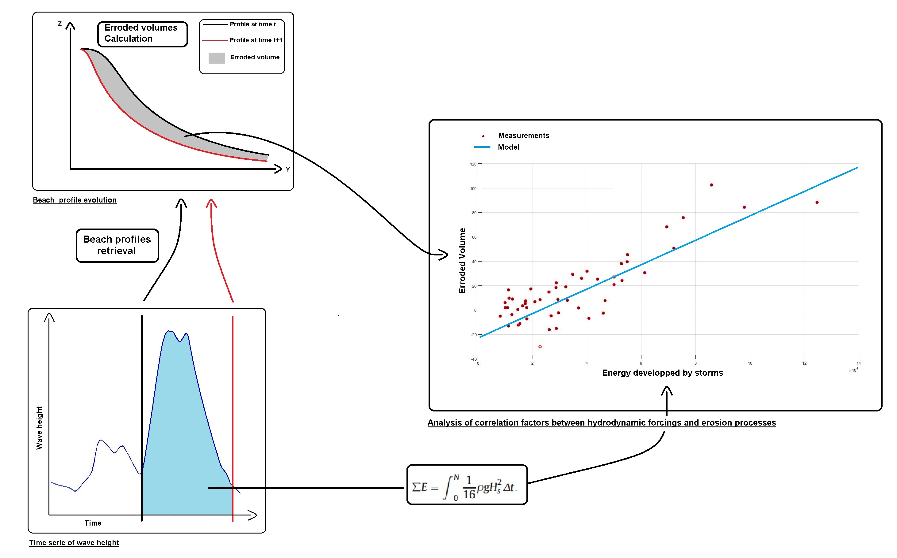

# Beach_erosion — storm erosion at Truc Vert (SW France), 2017 indicator revisited in 2026

## A hydro-morphological analysis of storm erosion on the south-west French coast

Storm-induced beach erosion is still an open research question. This project asks how well a single storm-energy
variable (built from wave height and storm duration) explains the volume of sand a beach loses during storms. The
original work (2017 M2 internship at BRGM, Python port in 2020) used about 5 years of hindcast wave and water-level
data and 162 topographic surveys of Truc Vert beach (Gironde, France); the legacy files in `datasets/` hold
2008–2014 forcing and 168 profiles. It was designed as a simple first model on
the way to a local storm-erosion early-warning system.

The schematic below summarises the original method (details in
[`Storm Impact Indicator_2.ipynb`](Storm%20Impact%20Indicator_2.ipynb)).



## The project in five lines

1. **Question:** can storm-erosion volume ΔV (m³/m) at Truc Vert be predicted from the wave energy that reaches the upper beach?
2. **2017 answer:** the *Eroded Volume Indicator* (EVI), a linear fit ΔV = a·E + b, weak on raw data (R² 0.26) and strong only after filtering.
3. **2026 revisit (branch `revisit-2026`):** reproduce and audit that pipeline, extend the data to 2003–2019, and test physics, equilibrium and ML models under a leakage-free protocol.
4. **Honest outcome:** nothing beats the 2017/2018 EVI by more than its confidence interval on held-out winters; survey spacing, not the model, is the first-order limit.
5. **Goal:** a peer-reviewed paper co-written with the original supervisors (see [`paper/outline.md`](paper/outline.md)).

## What changed in 2026

Numbers are from [`STATUS.md`](STATUS.md) §2; each one is traced to a report in [`reports/`](reports/README.md).

- **The EVI is already published.** It is Nicolae Lerma, …, Gillet, … & Castelle (2018), *J. Coastal Research* SI 85:666–670 (R² 0.83 / RMSE 7.7 m³/m with pre-storm state). The new work is therefore a revisit, audit and extension of a published indicator.
- **Audit.** The 2020 notebook is reproduced exactly (PPT test R 0.97, n = 8), but that number is fragile: fixing the profile-crossing routine alone drops it to 0.47. Ten of the 11 issues listed in HANDOFF §2.1 were confirmed. The clean, leakage-free EVI explains R² 0.24 of calibration variance (n = 35; thesis 0.26) and R² 0.53 [0.07, 0.70] on validation (n = 11).
- **HAT datum.** HAT (PHMA) is **+2.14 m above MSL** (SHOM RAM, Cap Ferret), not +1.75 m. All final tables use 2.14 m; the 1.75 m versions are kept as `*_hat175` for sensitivity.
- **More data.** Castelle et al. (2020) open surveys (325 surveys, 2003–2019, CC0), hourly directional waves, tide gauges and NAO. The event table grows from **51 events (v1, 2008–2014) to 98 events (v2, 2008–2019)**.
- **Models.** Leave-one-winter-out skill vs climatology on resolvable events (ΔV upper beach): EVI 0.46 [0.24, 0.62] on v1 and 0.37 [0.06, 0.58] on v2; the best model on v2, Equilibrium B, reaches 0.46 [0.27, 0.63], a small, non-significant gain. Tree models and Gaussian processes never win with n ≈ 50–90 events.

## Where to read first

1. [`STATUS.md`](STATUS.md): what was done, key numbers, what failed, prioritised to-do list.
2. [`reports/DECISIONS.md`](reports/DECISIONS.md): every decision taken during the 2026 sessions, with its rationale.
3. [`reports/README.md`](reports/README.md): index of all reports (audit, data, models, literature, supervisors, review, publishing, sand physics, recent findings, El Niño).
4. [`paper/outline.md`](paper/outline.md): titles, abstract, section plan, figures and journals for the paper.
5. [`HANDOFF.md`](HANDOFF.md): the original brief for the AI agents (mission, thesis summary, workstreams, guardrails). Keep it as the agent brief.
6. [`docs/GLOSSARY.md`](docs/GLOSSARY.md): every acronym and label used in the reports (EVI, PPT, HAT, LOWO, v1/v2, …).

## Repository map

```
Beach_erosion/
├── README.md                      this file (front door)
├── HANDOFF.md                     brief for AI agents: mission, 2017 summary, workstreams A–F, guardrails
├── STATUS.md                      state of branch revisit-2026: results, failures, to-do
├── Makefile                       shortcuts: make env | test | tables | audit | models | report | download
├── pyproject.toml                 package `evi` (src/ layout) + pytest configuration
├── requirements.txt               direct dependencies (ranges)
├── requirements.lock.txt          exact versions used in 2026 (uv pip freeze)
├── Storm Impact Indicator_2.ipynb LEGACY (2020) notebook port of the 2017 method; read-only
├── datasets/                      LEGACY (2020) input data: WW3/MARS2D forcing CSV, 168 profiles (.mat), raw 2010 netCDF; read-only
├── images/                        LEGACY method schematics (Schema_english.jpg is shown above)
├── docs/                          thesis PDF, text extraction, English key sections, glossary → docs/README.md
├── data/
│   ├── README.md                  provenance, licence, DOI and processing of every external dataset
│   ├── raw/                       downloads (git-ignored; recreated by scripts/download_*.py)
│   └── processed/                 committed harmonised tables: event/interval tables v1, v2, *_hat175, *_slopefix,
│                                  waves, tides, surveys, climate indices; schema in events_trucvert_schema.md
├── src/evi/                       Python package: loaders, storms, runup, energy, profiles, event tables, audit
│   └── models/                    evaluation protocol, baselines, ML models, run_all pipeline, figures, report filler
│                                  → src/evi/README.md
├── scripts/                       download_*.py / process_*.py for external data → scripts/README.md
├── tests/                         24 pytest unit/regression tests (test_*.py) + review_time_alignment.py (failing on purpose, not collected)
├── figures/                       model figures (PNG + CSV of the plotted data) and figures/tables/ (all model results) → figures/README.md
├── reports/                       one report per workstream + DECISIONS log + model cards → reports/README.md
├── paper/                         outline.md (paper plan), publication_checklist.md
└── notebooks/                     placeholder for thin notebooks that call src/evi (empty for now)
```

Legacy files (`Storm Impact Indicator_2.ipynb`, `datasets/`, `images/`) stay where they were in 2020 and are never
modified (DECISIONS D-3).

## How to reproduce

From the repository root. Each step is also a `make` target (`make help` lists them).

```bash
# 1. Environment (Python 3.12; uv recommended)                      make env
uv venv --python 3.12 .venv && source .venv/bin/activate
uv pip install -r requirements.lock.txt && uv pip install -e .

# 2. Tests: 24 tests, all expected to pass                          make test
pytest -q

# 3. Event tables (writes data/processed/)                          make tables
python -m evi.events          # v1: legacy repo data -> {events,intervals}_trucvert.{parquet,csv}
python -m evi.events_v2       # v2: Castelle 2020 + extended forcing -> *_trucvert_v2.*
python -m evi.slopefix        # alternative runup-slope tables -> *_slopefix.* (defaults untouched)

# 4. Audit numbers (notebook reproduction, corrected EVI models)    make audit
python -m evi.reproduce       # prints reports/A_audit.md §1 tables, writes data/processed/reproduction_A.json

# 5. Models (writes figures/ and figures/tables/; v1 ~2 min, v2 ~6 min)   make models
python -m evi.models.run_all --data v1    # also: v2, v2C (needs raw tide netCDF), v1s, v2s (add --no-figs)

# 6. Refresh the auto-generated tables in reports/C_models.md and the model cards   make report
python -m evi.models.report v1 v2 v2C

# 7. External data (network; see data/README.md for licences)      make download && make process
python -I scripts/download_castelle2020.py   # and the other scripts/download_*.py, then scripts/process_*.py
```

Raw downloads are not committed; processed tables are. Seeds are fixed, so steps 3–5 are deterministic on the
library versions in `requirements.lock.txt`. Committed results are frozen for this session (DECISIONS D-30):
re-running steps 3–6 overwrites committed files, so check `git diff` afterwards.

## Data licences (one line)

Castelle et al. (2020) surveys, waves and tide: CC0 1.0 · RESOURCECODE WW3 hindcast: CC BY-SA 4.0 [verify] ·
SHOM REFMAR tide gauges and RAM datums: Licence Ouverte 2.0 (REFMAR presumed [verify]) · NOAA CPC NAO: US public
domain [verify] · WEPA: CC BY-NC-ND, never committed · legacy `datasets/` (Ifremer WW3, MARS2D, OCA profiles):
licence not documented [verify]. Details in [`data/README.md`](data/README.md) and [`scripts/README.md`](scripts/README.md).

## How to cite

The indicator (published version):

> Nicolae Lerma, A., Bulteau, T., Muller, H., Decarsin, C., Gillet, R., Paris, F., Biausque, M., Sénéchal, N.,
> Castelle, B. (2018). Towards the Development of a Storm Erosion EWS for the French Aquitaine Coast. *Journal of
> Coastal Research*, SI 85, 666–670. https://doi.org/10.2112/SI85-134.1 (open PDF: HAL hal-01719953; the DOI
> printed on the HAL cover page is wrong, use this one).

The detailed source (in French):

> Gillet, R. (2017). *Élaboration d'un indicateur hydro-géomorphologique : un outil pour prévoir le risque
> d'érosion lors de tempêtes sur les plages sableuses aquitaines.* Master 2 thesis, DYNARISK, Université Paris
> Diderot / BRGM. [`docs/thesis/`](docs/thesis/M%C3%A9moire_Dynarisk_Gillet.pdf)

Extended survey data: Castelle, B., Bujan, S., Marieu, V., Ferreira, S. (2020). 16 years of topographic surveys of
rip-channelled high-energy meso-macrotidal sandy beach. *Scientific Data* 7, 410.
https://doi.org/10.1038/s41597-020-00750-5

Author: Raphaël Gillet. Portfolio: https://env-models.github.io/Portfolio-Gillet/
